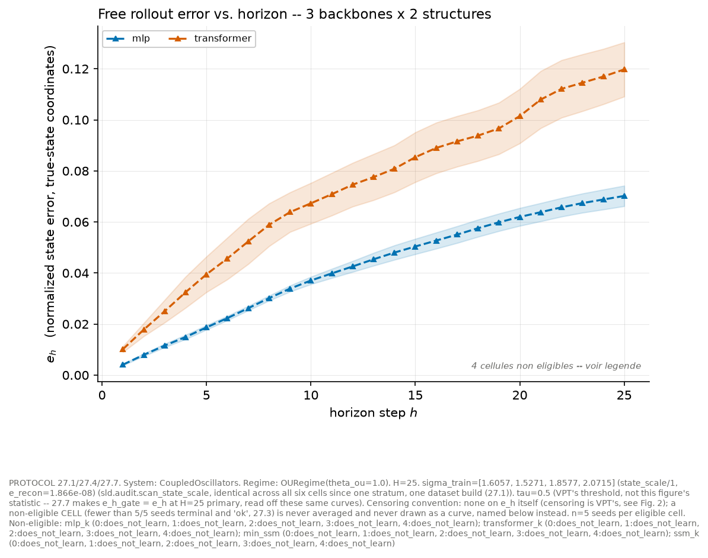

# structured-latent-dynamics

> Structured latent dynamics in JEPA world models: when does explicit dynamical structure improve rollout stability, state sufficiency, and planning — at what compute cost per successful decision.



*Free-running rollout drift vs. horizon (true-state coordinates, mean over 5 seeds with ±1 SE bands) across the architecture × constraint factorial — two pendulum panels at D1 (OU and action-conditioned regimes). The Lorenz-63 adversarial panel read in VPT arrives at D2.*

(generated by `make fig1` from the D1 grid; committed at D1 close)

## Motivation

When does explicit dynamical structure in a JEPA world model's latent predictor improve rollout stability, state sufficiency, and planning — at equal compute cost? Generic predictors (MLP, causal transformer) can fit the one-step loss well and still drift catastrophically under free-running rollout; structured predictors (2×2 rotation-scaling blocks, selective SSM, Koopman-style lifting) impose an explicit transition law on the latent state, at the cost of expressivity. This repo runs that comparison as a controlled factorial rather than a leaderboard.

The design crosses architecture (four predictor families) with a common constraint — a total-Jacobian penalty μ_J, calibrated across families to a comparable stability margin (see `PROTOCOL.md`) — and with data regime, on four custom dynamical systems (damped pendulum, coupled oscillators, Lorenz-63, CartPole). An audit panel separates what is displayed from what is measured: the spectrum (or field of local spectra) is display/screening only, never a stability certificate; stability is read off the total Jacobian on the augmented state; identifiability is read off R²/Procrustes recovery against the true state. The baseline every arm has to beat is val loss alone.

## Reproduce

```bash
make setup          # uv sync + editable install
make test           # full test suite
make smoke          # end-to-end factorial smoke (< 5 min)
uv run sld-factorial --config src/sld/experiments/configs/pendulum_core.yaml   # D1 grid (80 runs)
make fig1 fig2      # regenerate figures from results/, never retrains
```

Full core grid: ~550 runs, ~30-55 CPU-hours on a laptop — frugal by design.

## Pre-registered predictions (P1–P5)

Committed and tagged `pre-registration` before any run of the core grid or of the pre-registered LR/μ_J selection and calibration sweeps; both start counting from the tag (`PROTOCOL.md`'s three-category taxonomy: core grid, pre-registered selection & calibration runs, exploratory). Exploratory runs, before or after the tag, are logged in `PROTOCOL.md` section 9, never in either of the other two counts.

- **P1 (directional, decomposed by the factorial)** — (a) *constraint effect*: within each family, the ON cell produces more stable free-running (FR) rollouts than the OFF cell (drift at a fixed horizon, measured in true-state coordinates through a per-run fitted linear readout — the gauge-invariant endpoint declared in `PROTOCOL.md`; VPT on Lorenz arrives at D2). For `koopman_ssm`, ON is declared as a *package* — penalty **and** stable parametrization change together — so its contrast is not attributable to the penalty alone. ~~(b) *architecture effect*: at fixed constraint, the explicit spectral parametrization beats the generic families.~~ **P1(b) is withdrawn** — see "What didn't work" below and `PROTOCOL.md` section 11. It is withdrawn, not falsified: the constraint level it compares families *at* was never achieved across families, so no measurement of it exists.
- **P2 (sufficient state, falsifiable)** — the state deficit measured **before** moving to the contextual encoder (R²/Procrustes recovery against the true state) predicts **the order** of the contextual encoder's gains, announced in advance, on the available system × regime pairs (~8 at flagship scale — limited power, declared; the dozen pairs is the PhD-scale target). Killed if this order prediction does not beat the val-loss baseline.
- **P3 (directional co-adaptation)** — co-trained with the constrained predictor, the encoder produces latents with better recovery (R², Procrustes, modal separation) than with the generic family at the same budget. The direction is predicted, not just a change.
- **P4 (interventional)** — task pairs on the same environment and the same model, costs oriented toward well- vs. poorly-controllable directions, **constant oracle difficulty** (a CEM on the true RK4 dynamics succeeds equally on both orientations); prediction: the success gap is ordered by $r_{\mathrm{ctrl}}$ and $E_{\mathrm{ctrl}}$ (invariant forms, declared $R_u$ metric). Killed if the intervention does not produce the predicted order. The post-hoc correlational scatter can illustrate, never prove (endogenous).
- **P5 (stratification)** — gains from the structured arm (stability, planning, transition recovery) concentrate outside the OU regime (narrow-policy, anisotropic, action-conditioned). Under isotropic OU, **the exact zero expected concerns the orientation-identifiability gain** ($\bar A = \alpha I$, no reduced gauge) — not variance or stability, which can persist. Predicting zero everywhere would kill P5 for nothing.

## Robustness bars

Pre-registered decisions, not causal conclusions:

1. gains vanish under strict matching (params, FLOPs, updates, tuning) → **the claim is withdrawn** — we do not conclude "capacity effect", the experiment does not establish it;
2. stability via over-contraction (slow modes killed) → caught by the spectral panel + chaos metrics; the contraction-improves-MSE demo on Lorenz joins Fig 1 at D2 (D1's Fig 1 is pendulum-only);
3. better MSE but degraded planning → metric-objective divorce, publishable on its own; the repo switches to planner-facing metrics;
4. the contextual encoder explains everything, across all families → the bottleneck was the state; the secondary hypothesis wins and "What didn't work" says so.

Causal language, when it appears, is earned by the P4 intervention and by the factorial's cells — never by a correlation.

## D1 grid arithmetic

| Factor | Values |
|---|---|
| System | pendulum |
| Regime | OU, action-conditioned (2) |
| Predictor family | 4 |
| Constraint | OFF, ON (2) |
| Seeds | 5 |
| **Total** | **1 × 2 × 4 × 2 × 5 = 80 runs (D1)** |

Status: the 40 OFF cells are trained (39 complete, 1 divergence). The 40 ON cells are held pending `PROTOCOL.md` section 11.6 — the constraint level they were to be run at was never calibrated across families.

This is the **core grid** count only (`PROTOCOL.md`'s taxonomy). The pre-registered LR sweeps (OFF and ON cells) and μ_J calibration runs (`PROTOCOL.md` sections 2 and 5) are separate, published alongside these results, and not counted in the 80.

The full core grid (~550 runs, plan §3.9) arrives at D2. Models are ~10k predictor params, budget-matched ±5% (`PROTOCOL.md`).

## Results

**OFF half of the D1 grid: complete.** 4 families × 2 regimes × 5 seeds at the amended 200-update budget (`PROTOCOL.md` section 10.2), 39 cells trained, 1 divergence. `action_conditioned` / `min_ssm` / seed 4 produced a non-finite training loss at update 46 and aborted without success artifacts; it is reported as a divergence, not re-seeded and not dropped (`PROTOCOL.md` section 11.7).

**ON half: not run.** It waits on the dose-response study declared in `PROTOCOL.md` section 11.6. The four ON runs currently on disk are protocol-violation traces, kept and marked, never core evidence (section 11.5).

Figures 1-2 land here once the replacement study completes; nothing is reported before it does.

## What didn't work

**The matched-margin calibration — and it is the most informative thing this repo has produced so far.**

The design crosses architecture with a constraint that had to be *comparable* across families. That comparability was operationalized as a common band `[0.90, 1.00]` on a calibrated stability margin. It failed, in three stages, each of which the instrument caught itself:

1. **The first calibration measured almost nothing.** The trainer takes one optimizer step per epoch, so a "10-epoch" calibration budget was 10 updates — entirely inside the transient, where AdamW's partial loss-scale invariance makes the penalty weight inert. Measured: `cos(grad(μ_J=1), grad(μ_J=10))` = 0.9985, and a weight displacement of 0.3–0.8 % across four decades of μ_J.
2. **The first metric was not a measurement.** `σ_max` was read in undeclared coordinates. The same dense Jacobians give 1.0439 raw and 22.94 whitened for `min_ssm` — a factor-23 swing in the verdict under an equally defensible choice of basis. `REGLES.md` requires a diagnostic that fails the reparameterization stress test to be repaired or withdrawn; it was repaired, and a metric was declared (`PROTOCOL.md` section 10.3).
3. **With budget and metric repaired, the band was still reached by one family at one seed.** `mlp` selected μ_J = 0.01; `transformer` sat at 5.8–7.2, `min_ssm` at 1.06–1.33, `koopman_ssm` at 1.0326–1.0348 with a 0.2 % non-monotone response.

**Why it failed, as best we can support it.** The band asked four families to agree on one number while each family's margin is normalized by scales estimated on its *own* representation — an operational convention that was never established as physical comparability. Compounding it, the penalty minimizes a Frobenius-type norm while acceptance reads the top singular value, and reducing the former can redistribute the spectrum *upward* in the latter — consistent with `koopman_ssm`'s numbers, not proven on them. For the transformer, the audited quantity is a new-write sensitivity rather than contraction of the complete augmented state, so the same numeric band is not the same constraint.

**Consequence.** P1(b) compares architectures *at a fixed constraint*; no fixed constraint was ever achieved, so P1(b) is **withdrawn as unidentified** rather than declared false. What replaces it is a dose-response study that reports the achieved margin as a measured covariate instead of a controlled quantity (`PROTOCOL.md` section 11.6). What is *not* done, and why, is written out in section 11.4 — including the one mechanism that could have made the band reachable (a dual controller on the audited quantity) and the reason it is out of scope here rather than merely hard.

A gate was allowed to fail. The runs, the superseded verdicts and the reasoning stay published.

## Scope and limitations

- One core model size — a Pareto *slope* claim needs ≥ 3 sizes; that is Year-2 PhD work, not this repo.
- ATM is the Year-1 PhD baseline, out of flagship scope — the gap is declared, not measured here.
- CartPole here is a controlled-dynamics and planning bench, not an RL benchmark (distinct from the author's `rl_from_scratch` repo).
- ~8 system × regime pairs at flagship scale — limited power, declared.
- Spectral quantities are display/screening only; stability claims go through the total Jacobian audit.

## License

MIT — see [LICENSE](LICENSE).
