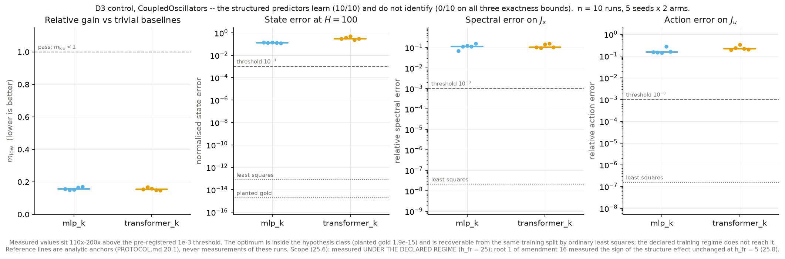
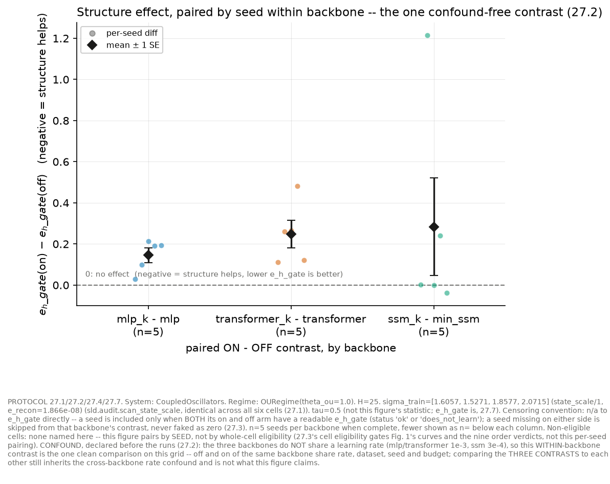
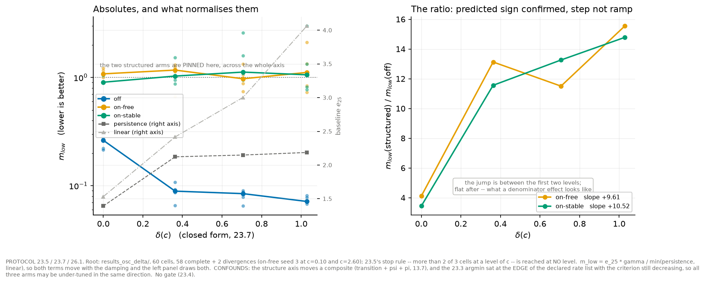

# structured-latent-dynamics

> When does an explicit dynamical prior in a JEPA world model's latent predictor help — and when it does not, why not.

**The short answer, on the one system where the prior is exactly correct: it does not help, and the reason is that the prior is a statement about a *basis*, not about coordinates.** Three measurements, in order.

| | | |
|---|---|---|
|  |  |  |
| **1. The optimum is inside the class.** A planted rotation-scaling operator is recovered to `1.9e-15`, and ordinary least squares finds it from data to `2.11e-08`. The theory is not the failure. | **2. Yet the structured arm loses.** Paired within backbone — same seed, dataset, rate and budget, the one confound-free contrast — structure *costs* `e_H`: `+0.1451 ± 0.0351` on `mlp` (5/5 seeds), `+0.2484 ± 0.0670` on `transformer` (5/5 seeds). | **3. Because the declared axis moved one of two misspecifications.** Where the spectral axis reads `δ(c) = 0.000` — "the prior is exact" — the true generator still sits `1.0654` from the class *in the identity basis*: **36 % of ‖A‖**. In its own real Jordan basis: `1.97e-15`. |

Gradient descent lands ~200× from an optimum that least squares reaches, and the isolating
ingredient is the **25-step closed rollout**, not the one-step loss — established by
elimination, not asserted (`PROTOCOL.md` 20.1). So the structured arm was never only fitting an
operator: it was being asked to discover a change of basis and the operator at once, from a
loss folded through 25 steps.

**The thesis this leaves standing:** a structural prior of the Koopman family is a claim about
a basis. Imposing the family in an arbitrary basis is not imposing the prior.

**Read next:** [`FINDINGS.md`](FINDINGS.md) — the study in six pages: question, design, the three
results above with their numbers, the diagnosis, and an explicit list of what it does not show.
[`PROTOCOL.md`](PROTOCOL.md) is the audit trail behind every figure quoted here; it opens with a
reading map, and is meant to be queried rather than read.

## Scope — what is measured, and what is not claimed

Every sentence above holds under: `CoupledOscillators`, `OURegime`, identity shared
representation, one rate list, one optimizer, `n ∈ {8, 32, 256}`, `δ(c) ∈ [0.000, 1.029]`,
`h_fr ∈ {5, 25}`. It is 209 cells across eight self-sufficient roots; `PROTOCOL.md` 23–28
carry every pre-registration, reading and confound.

- **Measured robust**: the sign is unchanged between `h_fr = 5` and `25` (25.8), across all
  three sample sizes and all four misspecification levels (23.5), and across two backbones
  each carried by 5/5 seeds (27.8.3, 27.9).
- **Measured, and explicitly *not* a third confirmation**: the `ssm` column's contrast
  (`+0.2836 ± 0.2379`) is set by a single seed against a median of `+0.0016`, in a backbone
  whose both arms fail the arm-neutral lower bound. 27.6 declared that risk before the runs;
  27.9 reports it rather than counting it.
- **Not a claim about structured world models in general.** 25.4 records a published result
  using the *same* parametrisation and reporting a gain, under a jointly learned
  representation. 26.0 measures the difference that most plausibly separates the two settings
  and names it a candidate — not as established.
- **Not a claim about the pendulum.** M4 is not crossed; 21.4 stands; seven of eight
  positive-control cells on `DampedPendulum` do not pass and nothing here reaches that system.

## The one experiment this diagnosis demands — run, and read under its pre-declared rule

If the penalty is the *joint* discovery of basis and operator, then handing the basis over
should remove it. `PROTOCOL.md` **28** pre-registered that test — `off` vs `on-learned` vs an
**oracle** arm whose `ψ` is frozen at the closed-form real Jordan transform — with three
predicted signs and a falsification clause written **before** the runs, binding the report of
every outcome. It ran on 2026-08-19, and the outcome is the one 28.4 had named in advance as
most likely (**28.7**):

**The coupling is a contributing mechanism; it is not sufficient to reverse the sign.**
Handing the structured arm the true basis helps on every seed (`on-oracle − on-learned` =
`−0.1302 ± 0.0340`, 0/5 seeds positive) and returns it to the positive-control gate the
learned-basis arm fails 5/5; it does not put the structured class ahead of the unstructured
one (`on-oracle − off` = `+0.0149 ± 0.0189`, 3/5 — indeterminate). The claim is bounded by
the word *oracle*: one system, one backbone, one stratum, basis given rather than learned.

## How this repository is meant to be read

The pre-registrations are load-bearing and the corrections are the point. Two conclusions were
withdrawn after measurement (22.0, 25.3's branch 1), two figures corrected their own readings
(24, 26.1), and one eligibility rule was found defective *after* scoring and left standing
rather than repaired (27.8.5) — because a rule moved with the numbers in hand is not a rule.
`REGLES.md` R4 (the contract precedes the run) and the correction-over-honesty hierarchy are
what the section numbering exists to enforce.

A withdrawn result is not a falsified one. Both are on the record, dated, beside the
measurement they revise.

## Motivation

When does explicit dynamical structure in a JEPA world model's latent predictor improve rollout stability, state sufficiency, and planning — at equal compute cost? Generic predictors (MLP, causal transformer) can fit the one-step loss well and still drift catastrophically under free-running rollout; structured predictors (2×2 rotation-scaling blocks, selective SSM, Koopman-style lifting) impose an explicit transition law on the latent state, at the cost of expressivity. This repo runs that comparison as a controlled factorial rather than a leaderboard.

**Calibrating that penalty to a margin comparable *across* families was attempted and failed.** Cross-family physical comparability of the calibrated margin was never validated, and the pre-registered common band was reached by one family at one seed. What follows from that — which predictions survive, which are withdrawn, which are unresolved — is in [`docs/historical_mu_j_campaign.md`](docs/historical_mu_j_campaign.md) and in `PROTOCOL.md` section 11. Read that before reading any number in this repo as a cross-family comparison.

The design crosses **backbone** (`mlp`, `transformer`, `ssm`) with **structure** (`off`/`on` — whether the backbone runs its structured variant, an architectural choice, never a numeric penalty) and with data regime. The package implements four systems (damped pendulum, coupled oscillators, Lorenz-63, CartPole); every published comparison is on `CoupledOscillators`, the pendulum carries only the positive-control root that gates it, and the other two systems have no published measurement here. This is the current primary axis; the paragraph above documents an earlier attempt to encode structure as a calibrated total-Jacobian penalty μ_J instead — that attempt failed and μ_J is now a secondary/regression study only (`src/sld/objectives/jac_reg.py`, `spectral_reg.py`, Fig. 2), never load-bearing for the thesis. An audit panel separates what is displayed from what is measured: the spectrum (or field of local spectra) is display/screening only, never a stability certificate; stability is read off the total Jacobian on the augmented state; identifiability is read off R²/Procrustes recovery against the true state. The baseline every arm has to beat is val loss alone.

## Reproduce

```bash
make setup          # uv sync + editable install
make test           # full test suite
make smoke          # end-to-end factorial smoke (< 5 min)
uv run sld-factorial --config src/sld/experiments/configs/pendulum_core_partial.yaml   # the 3 executed OFF arms of the 3x2 factorial (30 runs, ~17 min)
make figures        # figA-figG from their result roots
make fig1 fig2 fig3 # the primary-factorial trio (PROTOCOL 27.4), standalone
```

All **6** `backbone` x `structure` pairs now resolve to a predictor family: `(mlp,on)` → `mlp_k`, `(transformer,on)` → `transformer_k`, `(ssm,on)` → `ssm_k`, the three structured arms sharing one transition (`src/sld/predictors/structured.py`, `PROTOCOL.md` section 13.1). The registry holds **seven** families for those six cells: `KoopmanSSMPredictor` stays constructible and loadable so every published artifact keeps its constructor, and is never a cell of the factorial — an arm resolving to it is refused before any run.

`pendulum_core.yaml` is still **not runnable**: it is a frozen historical config kept on the retired `family`/`constraint` schema (the μ_J-era axis), and the backbone/structure validator refuses it outright. `pendulum_core_partial.yaml` above is the frozen record of the 30 OFF cells that ran. The full 3x2 grid (6 arms x 2 datasets x 5 seeds = 60 cells) is a **new pre-registration under a new result root**, and its training budget is not committed yet — no cell of it may execute until it is (`PROTOCOL.md` section 13.3).

Full core grid: ~550 runs, ~30-55 CPU-hours on a laptop — frugal by design.

## The retired μ_J campaign (historical)

The first design encoded structure as a calibrated Jacobian penalty (μ_J) rather than an
architectural switch. It failed its own calibration in three audited stages — a budget
that measured almost nothing, a metric whose verdict moved ×23 under an equally
defensible choice of basis, and a target band reached by one family at one seed — and
two candidate mechanisms for the failure were tested against the checkpoints and
refuted. The predictions it carried (P1–P5), the robustness bars, the grid arithmetic
and the full post-mortem are preserved **verbatim, exactly as measured**, in
[`docs/historical_mu_j_campaign.md`](docs/historical_mu_j_campaign.md); the complete
run trace (922 files, manifest-verified) is published under `reports/historical/mu_j/`.
That campaign is secondary/regression material — never load-bearing for the thesis
above (`PROTOCOL.md` §11).

## Scope and limitations

- One core model size — a Pareto *slope* claim needs ≥ 3 sizes; that is Year-2 PhD work, not this repo.
- ATM is the Year-1 PhD baseline, out of flagship scope — the gap is declared, not measured here.
- CartPole here is a controlled-dynamics and planning bench, not an RL benchmark (distinct from the author's `rl_from_scratch` repo).
- ~8 system × regime pairs at flagship scale — limited power, declared.
- Spectral quantities are display/screening only; stability claims go through the total Jacobian audit.

## License

MIT — see [LICENSE](LICENSE).
